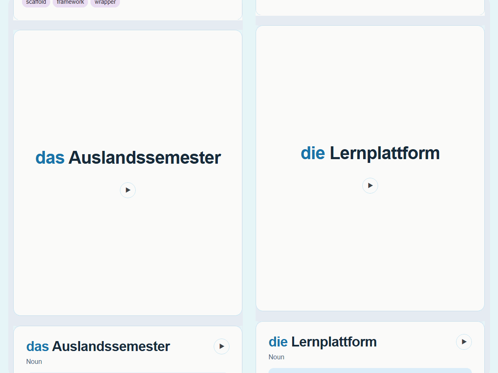

<h1> Anki Card Builder</h1>

Anki Card Builder turns your source material into rich, well-structured flashcards tailored to your learning goals. The skill recommends what to include, proposes card layouts and themes, and lets you preview and refine everything before batch creation in Anki. From simple vocabulary to context-rich, beautifully designed cards.

<p align="center">
  
</p>

## Setup

### Requirements

- Install the [AnkiConnect add-on](https://github.com/FooSoft/anki-connect) (Anki add-on code `2055492159`). Restart Anki after installation, and keep Anki open while using the server.
- Install Node.js 22.12.0 or newer.
- This MCP server supports **stdio** and **Streamable HTTP**. With stdio, a compatible client starts the local server process; with HTTP, you start the server and a compatible client connects to its URL.

### Install the MCP server

1. **Get the project.** Clone the repository once to get the skill and the project MCP configuration.

   ```sh
   # Download the project, including its skill.
   git clone https://github.com/Jia-57/anki-card-builder.git
   ```

2. **Install the server.** This server is based on [AnkiMCP](https://github.com/ankimcp/anki-mcp-server). Choose **one** installation method.

   **Build from source:** Use the repository you cloned in step 1.

   ```sh
   # Enter the server directory in the cloned project.
   cd anki-card-builder/packages/anki-mcp-server

   # Install dependencies, build, and install the server command.
   npm ci
   npm run build
   npm install -g .
   ```

   **From npm:**

   ```sh
   # Install the published MCP server.
   npm install -g @cardbuilder/anki-card-builder
   ```

3. **Start HTTP if selected.** For stdio, your MCP client starts the server when needed. For HTTP, run the command below and keep that terminal open while using Anki.

   ```sh
   # Start the local Streamable HTTP server at http://127.0.0.1:3000/.
   anki-card-builder-mcp
   ```

### Configure your agent

1. **Connect the MCP server.** Claude Code in this project uses the existing [`.mcp.json`](.mcp.json). For other clients, add a server in their MCP settings:

   - **stdio:** Enter command `anki-card-builder-mcp` with argument `--stdio`, or use this JSON if the client supports it:

     ```json
     {
       "mcpServers": {
         "anki-card-builder": {
           "command": "anki-card-builder-mcp",
           "args": ["--stdio"]
         }
       }
     }
     ```

   - **HTTP:** Keep the server running. Add a Streamable HTTP server in the client's MCP settings and enter this URL (not in a browser):

     ```text
     http://127.0.0.1:3000/
     ```

2. **Use the skill.** It is ready in this project. For another project, copy `.agents/skills/anki-card-builder/` into its `.agents/skills/`. For Claude Code, also copy `.claude/skills/anki-card-builder/SKILL.md` to the same path.

3. **Check the connection.** Open Anki, restart your client, and ask the agent to list your decks.

